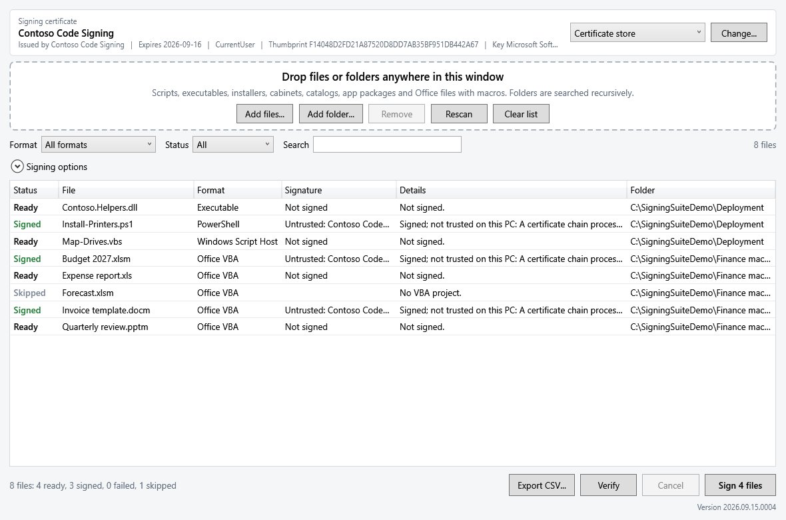

# Signing Suite

[](https://github.com/jasonulbright/signing-suite/releases/latest)
[](https://github.com/jasonulbright/signing-suite/releases)
[](#requirements)
[](#requirements)
[](LICENSE)

**Download:** [SigningSuiteSetup-2026.09.27.0007.exe](https://github.com/jasonulbright/signing-suite/releases/download/v2026.09.27.0007/SigningSuiteSetup-2026.09.27.0007.exe) (installer) or [SigningSuite-2026.09.27.0007.zip](https://github.com/jasonulbright/signing-suite/releases/download/v2026.09.27.0007/SigningSuite-2026.09.27.0007.zip) (portable)

WPF tool that Authenticode-signs scripts, executables, installers, cabinets, catalogs, app packages and the VBA projects in Office files. Drop files or folders onto the window; each file shows its format, its current signature and whether it can be signed, and one button signs the rest.



## Install

### Installer

Run `SigningSuiteSetup-<version>.exe`. Setup needs administrator rights and an internet connection: every prerequisite downloads from Microsoft during setup and is checked against a pinned SHA256 hash before it runs. Prerequisites that are already installed are skipped.

| Component | Default | What setup does |
|---|---|---|
| Signing Suite | Always installed | Copies the app to `C:\Program Files\Signing Suite` and adds a Start menu shortcut (and a desktop shortcut unless you clear it). The shortcut runs `powershell.exe -STA -ExecutionPolicy Bypass -WindowStyle Hidden -File start-signingsuite.ps1`. |
| Office signing add-in | Selected | Installs the Visual C++ runtime (x64 and x86) when missing, extracts the Office SIPs to `C:\Program Files\Microsoft Office SIPs\x64` and `x86`, and registers them. |
| Windows SDK signing tools | Selected | Installs `signtool.exe` with `winsdksetup.exe /features OptionId.SigningTools`. |
| Artifact Signing Client Tools | Selected | Installs the Microsoft MSI. It installs into the profile of the account that runs setup. |
| Azure CLI | Selected | Installs the 64-bit Azure CLI MSI. |

Clear any selected component on the **Select Components** page. Uninstall removes the app; prerequisites stay installed.

The installer carries a timestamped Authenticode signature; the scripts it installs are not signed. Windows SmartScreen may still show "Windows protected your PC" for a new release; select **More info**, then **Run anyway**.

Silent install (installs every component):

```bat
SigningSuiteSetup-<version>.exe /VERYSILENT /SUPPRESSMSGBOXES /NORESTART /LOG="%TEMP%\SigningSuiteSetup.log"
```

Limit components with `/COMPONENTS="app,officesips,sdktools"`. Pass Windows Installer public properties to the MSI prerequisites with `/ArtifactSigningProperties="ADDLOCAL=ALL"` and `/AzureCliProperties="ALLUSERS=1"`; the value is appended to that package's `msiexec` command line after `/qn /norestart` and written to the log. Setup returns 0 on success and a non-zero exit code when a prerequisite download or installation fails; the log names the step. When setup runs as SYSTEM (for example from a software deployment tool), Artifact Signing Client Tools install into the SYSTEM profile, not into users' profiles.

### Portable zip

Extract `SigningSuite-<version>.zip` to any folder and double-click `SigningSuite.cmd`. It starts the app in Windows PowerShell with `-ExecutionPolicy Bypass` and no console window. Install the prerequisites in [Requirements](#requirements) yourself.

## Formats

| Format | Extensions | Engines |
|---|---|---|
| PowerShell | .ps1 .psm1 .psd1 .ps1xml .psc1 .cdxml | SignTool, PowerShell |
| Windows Script Host | .vbs .vbe .js .jse .wsf | SignTool, PowerShell |
| Executable | .exe .dll .sys .ocx .scr .cpl .efi .drv .winmd .mui .com | SignTool, PowerShell |
| Windows Installer | .msi .msp .mst .msm | SignTool, PowerShell |
| Cabinet | .cab | SignTool, PowerShell |
| Catalog | .cat | SignTool, PowerShell |
| Office VBA | .xlsm .xlsb .xltm .xlam .docm .dotm .pptm .potm .ppam .ppsm .vsdm .vssm .vstm and .xls .xlt .xla .doc .dot .wiz .ppt .pot .pps .ppa .mpp .mpt .pub .vsd .vss .vst .vdw | SignTool, PowerShell |
| App package | .msix .appx .msixbundle .appxbundle | SignTool |

Windows decides whether it can sign a file by asking the Subject Interface Package (SIP) registered for it. A file no SIP recognizes, such as a renamed text file with an .exe extension, is marked Failed without being opened for signing.

## Requirements

| Requirement | Details |
|---|---|
| PowerShell | Windows PowerShell 5.1. PowerShell 7 is not supported: the window restarts itself in Windows PowerShell, and the command-line script refuses to run. |
| signtool.exe | Optional. From the Windows SDK ("Signing Tools for Desktop Apps"). Needed for app packages, RFC 3161 timestamps, dual signing, Artifact Signing and digest signing libraries. The tool finds the newest SDK build, or you choose the file. A signtool.exe from the SDK, from PATH or from the chosen path is used only with a valid Microsoft signature. |
| Office SIPs | Needed for Office files: [Microsoft Office Subject Interface Packages for Digitally Signing VBA Projects](https://www.microsoft.com/download/details.aspx?id=56617), registered with `regsvr32` for the bitness of the PowerShell process. `msosipx.dll` covers the Open XML formats, `msosip.dll` the binary formats. The Office installation itself is not used. |
| Artifact Signing | Optional. [Artifact Signing Client Tools](https://learn.microsoft.com/azure/artifact-signing/how-to-signing-integrations) (`winget install -e --id Microsoft.Azure.ArtifactSigningClientTools`), an account, a certificate profile and the Certificate Profile Signer role. |
| Rights | Standard user. Registering the Office SIPs needs administrator rights once. |

The scripts are not signed. If your execution policy requires signed scripts, unblock the downloaded zip before extracting it or start the tool with `-ExecutionPolicy Bypass`.

## Usage

```powershell
powershell.exe -NoProfile -STA -File .\start-signingsuite.ps1

# List files or folders at startup
powershell.exe -NoProfile -STA -File .\start-signingsuite.ps1 'C:\Build\Output' 'C:\Scripts\Deploy.ps1'
```

1. Pick the signing identity at the top: **Certificate store**, **Artifact Signing** or **Digest signing library**, then **Change...**.
2. Add files or folders. Folders are searched recursively for every format in the table.
3. Check **Signing options**.
4. **Sign N files** shows the identity, files and options, and signs the Ready and Failed files that the current filter shows after you confirm.

### Signing identities

| Identity | What you provide | Notes |
|---|---|---|
| Certificate store | A code-signing certificate with its private key in `CurrentUser\My` or `LocalMachine\My`, or a .pfx to import | Smart cards and hardware tokens appear here when their certificate is in the store; the key provider column names them. The token may ask for a PIN for each file. |
| Artifact Signing | `Azure.CodeSigning.Dlib.dll` (found automatically after installing the client tools) and a `metadata.json` naming the endpoint, account and certificate profile | The dialog can write `metadata.json`. Sign in with Azure CLI, Azure PowerShell, Visual Studio, or `AZURE_CLIENT_ID`/`AZURE_TENANT_ID`/`AZURE_CLIENT_SECRET` first. Use `http://timestamp.acs.microsoft.com` with RFC 3161; the certificates are valid for three days. |
| Digest signing library | Any library signtool loads with `/dlib`, its metadata file (`/dmdf`), and the public certificate (.cer) unless the library supplies it | For HSM and cloud key services that ship a signtool plug-in. |

### Engines

**Automatic** uses SignTool when signtool.exe is found and PowerShell otherwise. **PowerShell** uses `Set-AuthenticodeSignature`, which adds Authenticode (legacy) timestamps and one signature per file. The tool refuses a combination the chosen engine cannot sign and says why in the Details column instead of signing differently than asked.

### Options

| Option | Effect |
|---|---|
| File digest | SHA256, SHA384 or SHA512. |
| Timestamp | RFC 3161 (SignTool), Authenticode legacy, or None. The server defaults to `http://timestamp.digicert.com`. |
| Dual sign | Executables and cabinets get a SHA1 signature with an Authenticode timestamp, then the selected digest appended. Other formats hold one signature and are signed once. |
| Skip files already validly signed by this identity | Leaves a file alone only when its valid signature comes from the selected certificate. A file validly signed by another publisher is signed again, because clients trust only the publishers in their Trusted Publishers store. Artifact Signing issues a certificate per run, so with that identity any valid signature is skipped and the confirmation dialog names the signers. |
| Remove existing VBA signatures | Runs `offclearsig.exe` from the Office SIP folder before signing Office files. The confirmation dialog names the affected files. |
| Description, description URL | signtool `/d` and `/du`. |

### Confirmation before signing

**Sign** opens a confirmation dialog before any file changes. It shows the identity that will sign (certificate name, issuer, expiry, thumbprint and key provider; or the Artifact Signing account, certificate profile and endpoint; or the digest signing library and its certificate), the number of files by format, and the options in use. Warnings name files that already carry another signer's signature, a missing timestamp, a certificate that expires within 14 days, and VBA signatures that will be cleared. **Cancel** is the default button: Enter and Escape both leave the files unchanged.

### Removing signatures

**Remove signatures...** unsigns the signed files the current filter shows, after a confirmation dialog that lists the signers and the file count. Scripts, executables, installers and app packages are unsigned through the Subject Interface Package Windows registers for the file type; Office files through `offclearsig.exe`. Cabinets and catalogs are never offered: Windows has no removal path for a cabinet signature, and a catalog is itself a signature. Unsigned files return to **Ready**.

## Behavior

- Office files are signed three times: the Office SIPs add the legacy, agile and V3 VBA signatures on successive passes. A file that already has the legacy and agile signatures only receives the V3 signature again; remove existing signatures to re-sign from scratch.
- Open XML Office files count as macro files when the package contains `vbaProject.bin`. Binary Excel and Word files count when they contain a `_VBA_PROJECT` storage. PowerPoint, Visio, Project and Publisher binary files are signed and reported as Skipped if they turn out to have no VBA project. Office owner files (`~$*`) are ignored.
- App packages are checked before signing: the manifest `Publisher` must equal the certificate subject, which signtool otherwise reports as `0x8007000B`.
- The Signature column reads the embedded signature with WinVerifyTrust. It does not report catalog signatures, so a copy of a Windows system file shows as not signed until you sign it. The list does not check revocation and makes no network calls; **Verify** and `-Verify` check revocation online and report a revoked signer as **Revoked**. Offline, Verify reports the signature as untrusted with the reason.
- Status: **Ready**, **Signed**, **Failed** (Details has the reason), **Skipped** (not signable, empty, or no VBA project). **Sign** retries Failed files.
- Files are signed in place. Read-only files are not changed.
- A banner appears when Office files are listed and the Office SIP is missing, partly registered, or registered only for the other bitness, with a download link or a restart into the matching Windows PowerShell.
- A second banner appears when signtool.exe is not found.
- Drag-and-drop from Explorer does not reach an elevated window (Windows UIPI); the drop zone warns when the tool runs as administrator.
- Settings are saved to `%APPDATA%\SigningSuite\settings.json` when the window closes.

### Keyboard

| Keys | Action |
|---|---|
| Ctrl+O | Add files |
| Ctrl+Shift+O | Add folder |
| Delete | Remove selected files from the list |
| F5 | Rescan the listed files |
| Ctrl+F | Search |
| Ctrl+Enter | Sign |
| Ctrl+E | Export CSV |
| Esc | Cancel the running scan, signing, verification or signature removal after the current file |

Signing and signature removal have no shortcut that skips the confirmation dialog.

## Trusting signatures on clients

A signature is trusted only where the certificate chains to a trusted root and, for scripts and macros, where the certificate is a trusted publisher.

- Office macros: with **Disable all except digitally signed macros** and **Require macros to be signed by a trusted publisher**, deploy the public certificate to **Trusted Publishers** (Group Policy: Computer Configuration > Policies > Windows Settings > Security Settings > Public Key Policies > Trusted Publishers, or `certutil -addstore TrustedPublisher <certificate>.cer`). Add-ins that carry Mark of the Web are not trusted through a signature.
- PowerShell: `AllSigned` and `RemoteSigned` execution policies need the publisher in Trusted Publishers as well.
- App packages install only when the certificate chains to a root the device trusts.

References: [Trusted publishers for Office files](https://learn.microsoft.com/microsoft-365-apps/security/trusted-publisher), [SignTool](https://learn.microsoft.com/windows/win32/seccrypto/signtool), [Sign an MSIX package](https://learn.microsoft.com/windows/msix/package/signing-package-overview).

## Command line

`Invoke-SigningSuite.ps1` signs or verifies without the window and writes one result object per file. It exits with 1 when any file failed, so a build step fails with it. `-WhatIf` lists what would be signed.

```powershell
# Certificate store, RFC 3161 timestamp
powershell.exe -NoProfile -File .\Invoke-SigningSuite.ps1 -Path .\out -CertificateThumbprint <thumbprint> -TimestampMode Rfc3161 -TimestampServer http://timestamp.digicert.com

# Artifact Signing
powershell.exe -NoProfile -File .\Invoke-SigningSuite.ps1 -Path .\out\App.msix -ArtifactSigningMetadata .\metadata.json -TimestampMode Rfc3161 -TimestampServer http://timestamp.acs.microsoft.com

# Digest signing library with its certificate
powershell.exe -NoProfile -File .\Invoke-SigningSuite.ps1 -Path .\out -DlibPath C:\Tools\Hsm.Dlib.dll -DlibMetadata .\hsm.json -CertificateFile .\signer.cer

# Verify with an online revocation check; exits 1 when a signature is invalid, revoked or unreadable
powershell.exe -NoProfile -File .\Invoke-SigningSuite.ps1 -Path .\out -Verify

# Remove signatures; -WhatIf lists the signed files without changing them
powershell.exe -NoProfile -File .\Invoke-SigningSuite.ps1 -Path .\out -RemoveSignature
```

The other options match the window: `-Engine`, `-DigestAlgorithm`, `-DualSign`, `-SkipValid`, `-ClearOfficeSignatures`, `-Description`, `-DescriptionUrl`, `-SignToolPath`.

## Module

`Module\SigningSuite` holds everything except the window and works on its own:

```powershell
Import-Module .\Module\SigningSuite\SigningSuite.psd1
$certificate = Get-SigningCertificate | Select-Object -First 1
Find-SignableFile -Path C:\Build\Output | ForEach-Object {
    Invoke-FileSigning -LiteralPath $_ -Engine SignTool -SignToolPath (Find-SignTool).Path -Certificate $certificate `
        -TimestampMode Rfc3161 -TimestampServer http://timestamp.digicert.com
}
```

## Tests

```powershell
Invoke-Pester -Path .\Tests
```

Requires Pester 5. Tests never write to a certificate store: they sign with throwaway self-signed certificates whose keys are deleted afterwards. Digest signing and app package tests need signtool.exe and build a test signing library with the Visual Studio C++ tools; Office VBA tests need the Office SIPs and `SIGNINGSUITE_OFFICE_FIXTURES` (see `Tests/Tools/New-OfficeFixtures.ps1`). Tests whose tools are missing are skipped.

## File structure

```
start-signingsuite.ps1          # WPF entry script
Invoke-SigningSuite.ps1         # Command-line signing, verification and signature removal
MainWindow.xaml                 # Main window
Module/SigningSuite/            # Signing, scanning, verification, settings
    SigningSuite.psd1
    SigningSuite.psm1
    Private/*.ps1
Tests/                          # Pester tests, test helpers, native test signing library
tools/Build-Release.ps1         # Release zip and checksums
```
